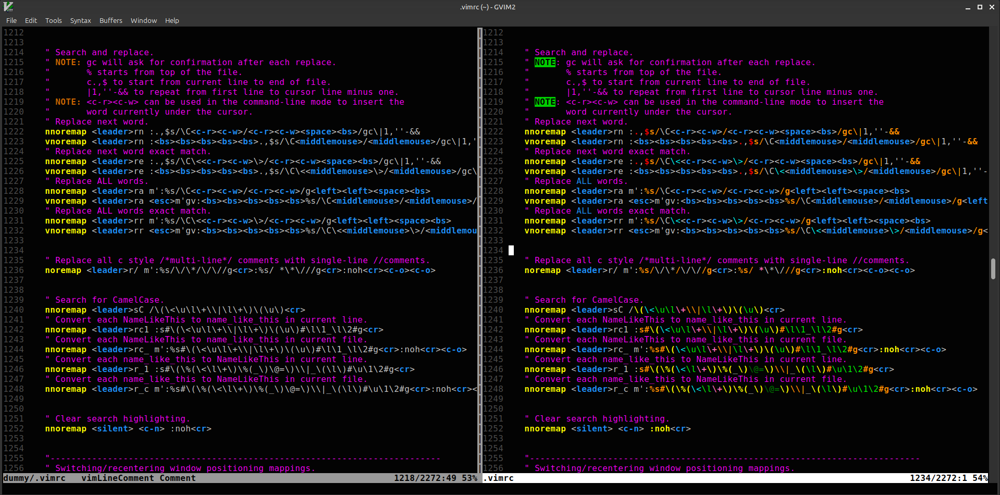
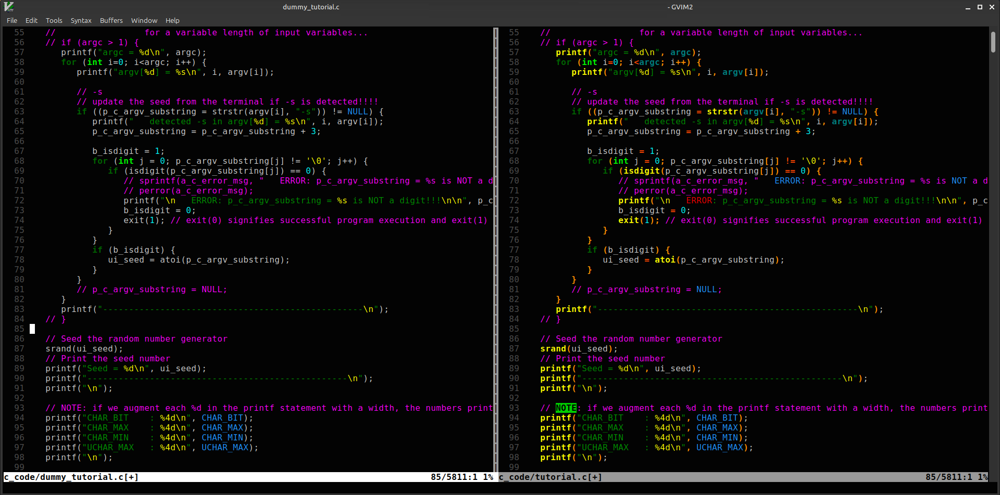

# vimrc

Contains all my vimrc settings.

## Features

- Works in GVim, Vim and NeoVim
- Supports Windows and Linux OS
- Supports Colemak-DH and QWERTY keyboard layouts
- Uses a custom colorscheme fully controlled by the user
- Supports different syntax configurations
- Can select between Vim's syntax matching, or add custom syntax matching on top of the Vim's syntax matching (default), or completely override Vim's syntax matching
- Contains custom syntax library files that can add custom syntax matching to any filetype in addition to filetype specific customizations
- Contains font and GUI customizations
- Adds font styles such as bold, underline, italic, colors, strikethrough and other combinations
- Displays the name of the syntax group being applied under the cursor
- Includes performance optimization features and multiple performance modes
- Includes AI Integration with Pasky's plugin for using Anthropic's Claude AI via an API (Now also supports OpenAI/ChatGPT, Gemini and Qwen/Ollama!!!)
- Includes custom mappings and abbreviations
- Adds improved Unicode support with tpope/vim-characterize plugin, and added a function to search in Unicode names
- Improved search and replace functionality with mappings
- Contains autocorrect and spell checking support
- Can emulate clipboard utility selections and copying if not supported or properly working such as in NeoVim or Windows

## .vim/ Folder Contents
```
.vim/
├── colors/                     # Contains custom colorschemes
├── lib/
│   ├── abbrev.vim              # Common abbreviations and shortcuts
│   ├── all_colors.vim          # Contains and highlights all the colored names available in Vim.
│   ├── linux.vim               # Linux commands custom syntax highlighting
│   ├── math_mappings.vim       # Math/Unicode mappings from VSCode/Lean
│   ├── math.vim                # Math custom syntax highlighting and abbreviations
│   ├── more_colors.vim         # Adds additional highlighting groups and colors
│   ├── regex.vim               # Regular expression custom syntax highlighting
│   ├── spell.vim               # Spell checking configurations
│   ├── syntax_library.vim      # Library of syntax highlighting functions for use in all filetypes
│   └── unicode.vim             # Unicode support and abbreviations
├── pack/
│   ├── colorschemes/start/ddd_colorschemes/    # Contains ddd_colorschemes
│   ├── pasky/start/claude.vim/                 # Pasky's plugin for using Anthropic's Claude AI via an API
│   └── plugins/start/vim-characterize/         # Pressing ga now gives additional Unicode information
├── plugin/
│   └── matchparen.vim          # Matching parenthesis highlighting overrides
├── syntax/
│   ├── custom_syntax.vim       # Loads the custom syntax highlighting groups based on file extension
│   ├── lean.vim                # Lean math prover custom syntax highlighting
│   ├── rcf.vim                 # RCF custom syntax highlighting
│   └── text.vim                # Plain text custom syntax highlighting
├── thesaurus/
│   └── abbrevlist.txt          # Abbreviations list from all files for thesaurus lookup
└── after/
    ├── ftplugin/
    │   └── qf.vim              # Quickfix window statusline override
    └── syntax/
        ├── asm.vim             # Assembly custom syntax highlighting
        ├── c.vim               # C/C++ custom syntax highlighting
        ├── csh.vim             # C shell custom syntax highlighting
        ├── java.vim            # Java custom syntax highlighting
        ├── javascript.vim      # JavaScript custom syntax highlighting
        ├── json.vim            # JSON custom syntax highlighting
        ├── lua.vim             # Lua custom syntax highlighting
        ├── markdown.vim        # Markdown custom syntax highlighting
        ├── netrw.vim           # File browser custom syntax highlighting
        ├── perl.vim            # Perl custom syntax highlighting
        ├── plaintex.vim        # Plain TeX custom syntax highlighting
        ├── python.vim          # Python custom syntax highlighting
        ├── qf.vim              # Quickfix window custom syntax highlighting
        ├── sh.vim              # Bash/shell custom syntax highlighting
        ├── svn.vim             # SVN custom syntax highlighting
        ├── tcl.vim             # TCL custom syntax highlighting
        ├── tex.vim             # LaTeX custom syntax highlighting
        ├── verilog.vim         # Verilog and SystemVerilog custom syntax highlighting
        ├── vhdl.vim            # VHDL custom syntax highlighting
        └── vim.vim             # Vim custom syntax highlighting
```

## Getting Started

To use, first install GVim, Vim or NeoVim on Linux or Windows (GVim being my main editor), and then place the .vim files in the appropriate location.
- For Linux, place the .vimrc file and the .vim/ folder in ~/ (aka $HOME/ or /home/username/) then open any file with GVim and the settings should all be loaded.
- For Windows, place the .vimrc file and the .vim/ folder under C:\Users\username\ (but rename the .vim folder to vimfiles in Windows) then open any file with GVim and the settings should all be loaded.


## NeoVim

NeoVim uses different configuration directories than Vim. You can get all the vimrc settings to work in NeoVim by 1) placing the files in the proper NeoVim directories and loading the Vim settings through the init.lua file or option 2) by linking NeoVim to Vim's .vimrc and .vim/ in Linux.


### Option 2) Linking NeoVim to Vim

Option 2) Linking NeoVim to Vim, can depend on the specific locations that NeoVim uses in your OS. Below is what works for me in Ubuntu/Mint Linux.

Link Vim's .vimrc and .vim/ subfolders in NeoVim.
```bash
ln -s ~/.vim/colors      ~/.config/nvim/colors
ln -s ~/.vim/spell       ~/.config/nvim/spell
ln -s ~/.vim/pack        ~/.config/nvim/pack
ln -s ~/.vim/after       ~/.config/nvim/after
ln -s ~/.vim/autocorrect ~/.config/nvim/autocorrect
ln -s ~/.vim/syntax      ~/.config/nvim/syntax
```

And add to ~/.config/nvim/init.lua
```lua
-- Source existing vimrc for shared config
vim.cmd('source ~/.vimrc')
```

Now when I open a file with NeoVim, it gets the same settings as when I load the file with GVim.


## Pasky's Plugin for using Anthropic's Claude AI

I was able to get Pasky's Claude AI API working in GVim, Vim and NeoVim on my Ubuntu/Mint Linux OS and I also got it working on my Windows OS using GVim (I have not tried NeoVim on Windows). The plugin works with the latest versions of Claude Sonnet and Opus (Once a new version comes out simply update the "g:claude_model" variable).

To get the Claude API to work, follow these steps:
1) Download the Pasky Plugin and place in you .vim folder

    A) I made modifications to Pasky's Claude API plugin that you can find in:
    https://github.com/dddansar/claude.vim
    and add it to your .vim/pack/pasky/start/claude.vim/

    OR

    B) You can download Pasky's Original Claude API plugin from:
    https://github.com/pasky/claude.vim
    and add it to your .vim/pack/pasky/start/claude.vim/
2) To confirm the plugin works for you, open a new vim window (ideally with an empty or a small file just to test it out), press <leader>cc to open a Claude prompt, type your question or command in the prompt, press ctrl-] to send you question or command, and Claude should start replying in the prompt window.
If you don't have an API key yet, you should get an error stating: "message":"x-api-key header is required"
3) Get an API key from https://platform.claude.com
4) Add the API key in g:claude_api_key in your .vimrc file:
```vim
let g:claude_api_key='add_api_key_here'
```
5) Try step 2 again and hopefully it works for you now.

NOTE: I made some modifications to Pasky's plugins (the May 2025 version) to address some issues I was having, to add new features and capabilities, to add my own improvements to the plugin, to make the chat experience better suit my personal preferences, to not use the claude\_\*\_prompt.md files (I prefer default prompts)...

Visit the following link for details:
https://github.com/dddansar/claude.vim

## Custom Colorscheme

The Vim files contains it's own independent custom colorscheme files found in ~/.vim/pack/colorschemes/start/ddd_colorschemes/colors/. The colorschemes are written in a clear, easy to understand and easy to modify format.

The colorschemes are independent from the rest of the files and settings. If you want to enable the custom colorschemes without bringing in any of the other files, simply add a colors/ folder in the appropriate location (usually in your .vim/ path), copy over the colorscheme files into the colors/ folder, and then load the colorscheme into your .vimrc file.

You can do so by adding the following line to your .vimrc file:

```vim
colorscheme ddd_black
```

If you are using NeoVim instead of Vim/GVim, then add the ddd_black.vim file to the equivalent path (~/.config/nvim/colors/ in Linux) and add one of the following to your init.lua file:

```lua
vim.cmd.colorscheme("ddd_black")
" vim.cmd("colorscheme ddd_black") " Also works
" vim.cmd[[colorscheme ddd_black]] " Also works
```

Make sure you don't have any other colorschemes enabled overriding the custom colorscheme.

### Comparison with/without my custom syntax matching.

Both images below use my ddd_black.vim file. The image on the left shows the default syntax matching and the image on the right adds my custom syntax matching on top.

Left  image: With g:select_custom_syntax = 1
Right image: With g:select_custom_syntax = 2

For vim files:



For C files:



### More Colorschemes

For a complete list of other colorschemes I have available, check out:
https://github.com/dddansar/colorschemes

